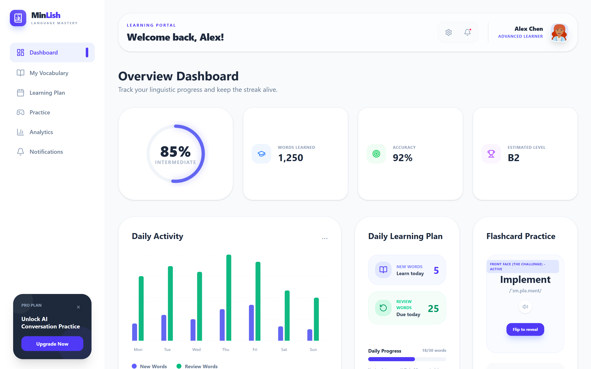
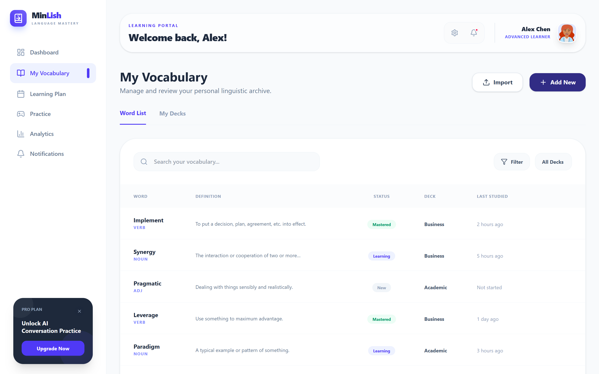
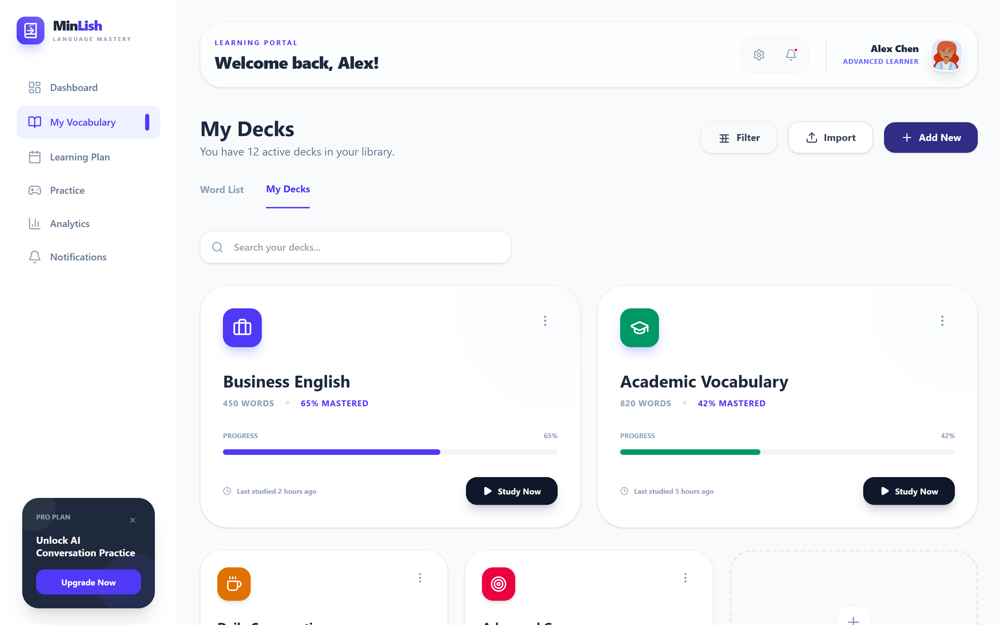
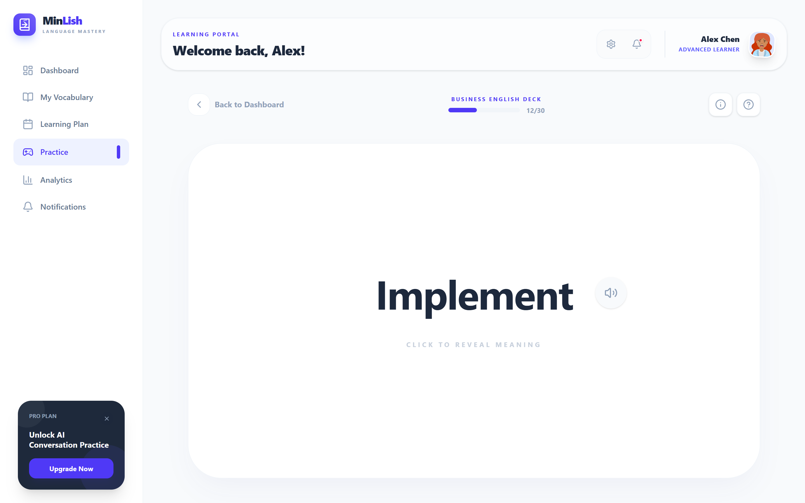
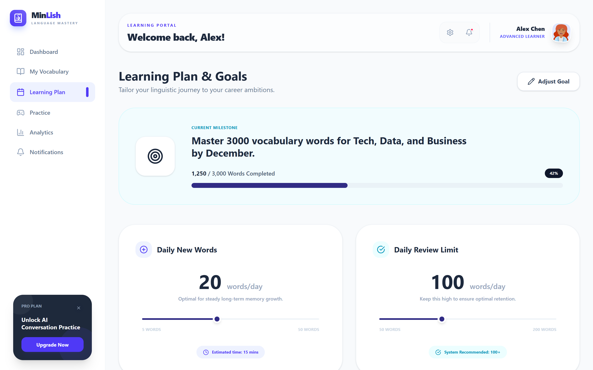
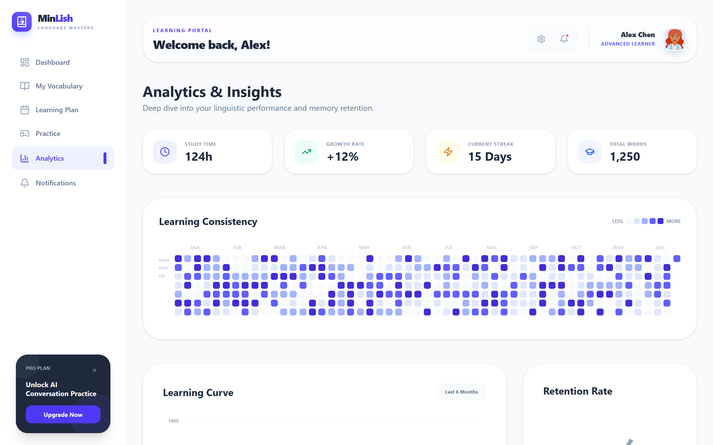
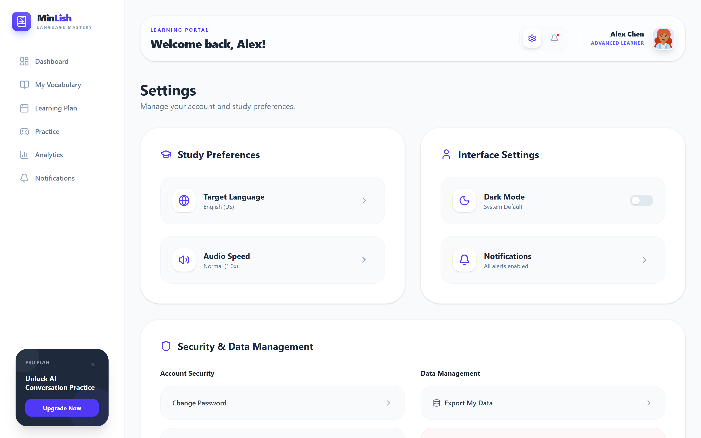
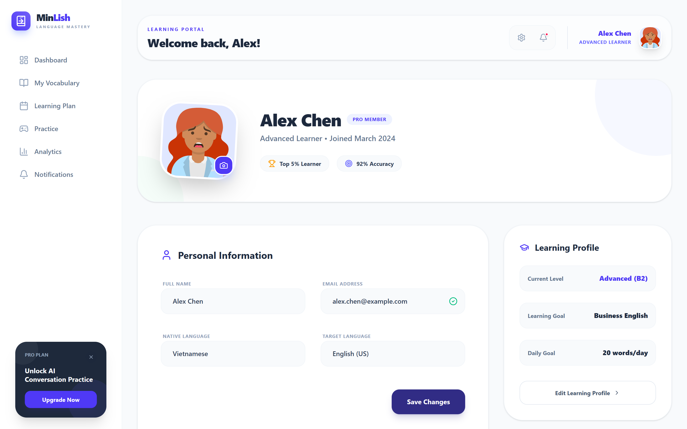

<div align="center">

# 🎓 MinLish - Modern English Learning & Vocabulary Dashboard

<p align="center">
  <strong>Nền tảng học từ vựng và theo dõi lộ trình tiếng Anh thông minh với giao diện hiện đại, trực quan</strong>
</p>

[](https://react.dev/)
[](https://vitejs.dev/)
[](https://tailwindcss.com/)
[](https://motion.dev/)
[](https://pages.github.com/)

[🚀 Trải nghiệm Live Demo](https://tranthimynuong.github.io/Minlish_doanoop/) • [✨ Tính năng chính](#-tính-năng-nổi-bật) • [📸 Màn hình ứng dụng](#-giao-diện-ứng-dụng) • [🛠 Cài đặt & Chạy](#-cài-đặt-và-chạy-cục-bộ)

---

</div>

## 📌 Giới thiệu dự án

**MinLish** là ứng dụng Web học từ vựng tiếng Anh được thiết kế theo phong cách hiện đại (Clean & Vibrant Dashboard). Ứng dụng cung cấp giải pháp toàn diện giúp người học xây dựng thói quen ghi nhớ từ vựng mỗi ngày, kết hợp phương pháp lặp lại ngắt quãng (**Spaced Repetition System - SRS**) cùng hệ thống phân tích lộ trình học tập trực quan.

Dự án hiện tại là phiên bản **Frontend Single-Page Application (SPA)** hoàn chỉnh, sẵn sàng triển khai trực tiếp lên **GitHub Pages** chỉ trong vài cú click!

---

## 📸 Giao diện ứng dụng

### 1. Tổng quan bảng điều khiển (Overview Dashboard)
Nơi hiển thị tiến độ học tập tổng quát, thẻ KPI (Words Learned, Accuracy, CEFR Level B2) cùng biểu đồ hoạt động tuần học tập.

<div align="center">
  
</div>

<br />

### 2. Quản lý từ vựng thông minh (My Vocabulary Archive)
Danh sách từ vựng chi tiết với bộ lọc thông minh theo Deck (Business, Academic, Daily Life) và trạng thái từ vựng (Mastered, Learning, New).

<div align="center">
  
</div>

<br />

### 3. Bộ sưu tập thẻ học (My Decks) & Thêm từ vựng mới
Phân loại các bộ thẻ từ vựng theo mục tiêu công việc hoặc kỳ thi chứng chỉ.

<div align="center">
  
</div>

<br />

### 4. Luyện tập Flashcard phương pháp ngắt quãng (SRS Practice)
Học từ vựng thông qua thẻ Flashcard tương tác mượt mà, hỗ trợ đánh giá mức độ ghi nhớ (*Again <1 min*, *Hard 2 days*, *Good 4 days*, *Easy 7 days*) và thao tác phím tắt nhanh (`Space`, `1`, `2`, `3`, `4`).

<div align="center">
  
</div>

<br />

### 5. Lộ trình học & Phân tích chi tiết (Learning Plan & Analytics)
Theo dõi kế hoạch hàng tuần và phân tích tỷ lệ hoàn thành mục tiêu học tập.

<p align="center">
  
  
</p>

<br />

### 6. Cài đặt thông báo & Hồ sơ cá nhân (Settings & Profile)
Quản lý lịch nhắc nhở học tập và hồ sơ học viên.

<p align="center">
  
  
</p>

---

## ✨ Tính năng nổi bật

- 📊 **Dashboard trực quan**: Theo dõi số từ đã thuộc (1,250+ từ), độ chính xác (92%), chuỗi ngày học liên tục (Streak).
- 🧠 **Flashcard SRS (Spaced Repetition)**: Thuật toán đánh giá chu kỳ lặp lại thông minh giúp từ vựng đi thẳng vào trí nhớ dài hạn.
- 🗂️ **Bộ lọc & Quản lý Deck**: Dễ dàng lọc, tìm kiếm và phân loại từ vựng theo chủ đề (Business, Academic, Daily Life,...).
- 📅 **Lộ trình cá nhân hóa (Learning Plan)**: Kế hoạch học tập 7 ngày trong tuần với số lượng từ mới và ôn tập rõ ràng.
- 📈 **Biểu đồ thống kê Recharts**: Trực quan hóa dữ liệu học tập hàng tuần với biểu đồ cột tương tác sống động.
- 🎨 **Giao diện hiện đại & Hiệu ứng Motion mượt mà**: Thiết kế theo tiêu chuẩn UI/UX cao cấp, tương thích tốt trên cả Desktop, Tablet và Mobile.

---

## 🛠 Công nghệ sử dụng (Tech Stack)

| Thành phần | Công nghệ |
| :--- | :--- |
| **Frontend Framework** | [React 19](https://react.dev/) + [TypeScript](https://www.typescriptlang.org/) |
| **Build Tool** | [Vite 6](https://vitejs.dev/) (Khởi động và build siêu tốc) |
| **Styling** | [Tailwind CSS v4](https://tailwindcss.com/) |
| **Animations** | [Motion (Framer Motion 12)](https://motion.dev/) |
| **Icons** | [Lucide React](https://lucide.dev/) |
| **Data Visualization** | [Recharts 3](https://recharts.org/) |
| **Deployment** | [GitHub Pages](https://pages.github.com/) qua [GitHub Actions](https://github.com/features/actions) |

---

## 💻 Cài đặt và Chạy cục bộ

### Yêu cầu tiên quyết:
- Đã cài đặt [Node.js](https://nodejs.org/) (khuyến nghị phiên bản 18+ hoặc 20+)

### Các bước thực hiện:

1. **Clone repository về máy:**
   ```bash
   git clone https://github.com/tranthimynuong/Minlish_doanoop.git
   cd Minlish_doanoop
   ```

2. **Cài đặt các thư viện phụ thuộc:**
   ```bash
   npm install
   ```

3. **Khởi chạy môi trường phát triển (Dev server):**
   ```bash
   npm run dev
   ```
   Sau đó mở trình duyệt truy cập: `http://localhost:3000`

4. **Đóng gói dự án (Production Build):**
   ```bash
   npm run build
   ```

---

## 🌐 Hướng dẫn Deploy lên GitHub Pages

Dự án đã được cấu hình sẵn CI/CD tự động bằng **GitHub Actions** tại [`.github/workflows/deploy.yml`](.github/workflows/deploy.yml) và `base: './'` trong `vite.config.ts`.

### Các bước kích hoạt trang Web trực quan trên GitHub:

1. **Khởi tạo và đẩy code lên GitHub:**
   ```bash
   git init
   git add .
   git commit -m "feat: initial commit with full frontend, screenshots and GitHub Pages workflow"
   git branch -M main
   git remote add origin https://github.com/tranthimynuong/Minlish_doanoop.git
   git push -u origin main
   ```

2. **Bật GitHub Pages trong thiết lập Repository:**
   - Truy cập vào: https://github.com/tranthimynuong/Minlish_doanoop/settings/pages
   - Tại phần **Build and deployment** > **Source**: Chọn **`GitHub Actions`**.

3. **Xem kết quả:**
   - Hệ thống sẽ tự động build và xuất bản trang web.
   - Sau khoảng 1-2 phút, trang web sẽ hoạt động trực tiếp tại địa chỉ:
     ```
     https://tranthimynuong.github.io/Minlish_doanoop/
     ```

---

## 📁 Cấu trúc thư mục dự án

```text
├── .github/
│   └── workflows/
│       └── deploy.yml        # CI/CD tự động deploy lên GitHub Pages
├── screenshots/              # Toàn bộ ảnh chụp màn hình chất lượng cao
│   ├── 01-dashboard.png
│   ├── 02-vocabulary.png
│   ├── 03-my-decks.png
│   ├── 05-practice-flashcard.png
│   ├── 06-analytics.png
│   ├── 07-learning-plan.png
│   ├── 08-settings.png
│   └── 09-profile.png
├── src/
│   ├── components/           # Các UI component (Dashboard, FlashCard, Modals,...)
│   │   ├── ui/               # Reusable UI cards, buttons, widgets
│   │   ├── Dashboard.tsx
│   │   ├── FlashCard.tsx
│   │   ├── PracticeView.tsx
│   │   ├── VocabularyTable.tsx
│   │   └── ...
│   ├── data.ts               # Dữ liệu từ vựng và lộ trình mẫu
│   ├── types.ts              # TypeScript interfaces
│   ├── App.tsx               # Root component điều hướng các tab
│   ├── main.tsx              # React DOM entry
│   └── index.css             # Tailwind CSS entry
├── index.html
├── vite.config.ts            # Cấu hình Vite với base: './'
└── package.json
```

---

<div align="center">
  <p>Được xây dựng với ❤️ dành cho cộng đồng học tiếng Anh</p>
</div>
